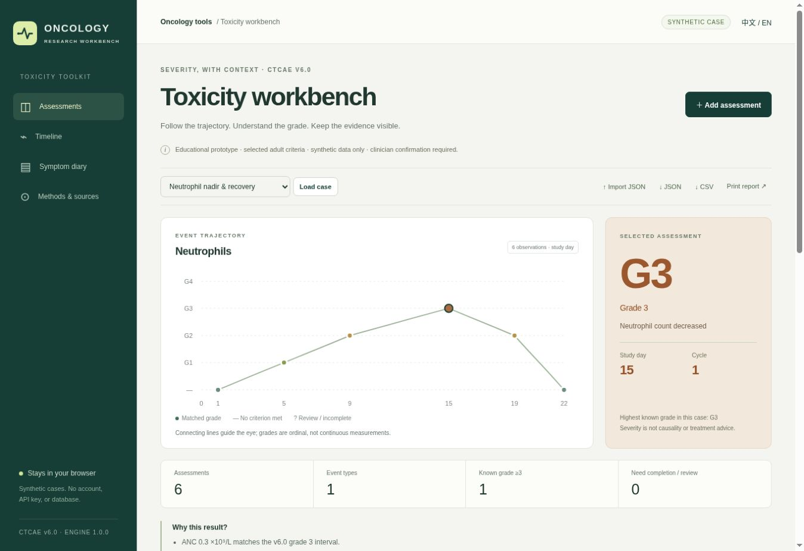

# Oncology Toxicity Workbench

An educational, browser-local workbench for selected **CTCAE v6.0** adverse-event criteria. Explore synthetic oncology cases, see exactly why a grade was assigned, and follow each event over study days.

[Live demo](https://ysm19990103.github.io/oncology-toxicity-workbench/) · [Clinical rules](docs/CLINICAL_RULES.md) · [Validation](docs/VALIDATION.md) · [中文说明](docs/README.zh-CN.md)




## What it does

- **Six laboratory events:** neutrophil count decreased, anemia, ALT increased, AST increased, blood bilirubin increased, and creatinine increased.
- **Three clinician-assessed symptom events:** diarrhea, nausea, and peripheral sensory neuropathy.
- **Traceable grading:** versioned rule identifiers, matched criteria, baseline branch, and page links to the NCI source.
- **Explicit uncertainty:** missing higher-grade features stay incomplete. Uncovered baseline combinations require review. No criterion met is never presented as CTCAE grade 0.
- **Longitudinal review:** an event trajectory, a multi-event timeline, and editable observation history with study days and cycles.
- **Separate diary:** custom 0–10 educational intensity/interference scores. These are not PRO-CTCAE and never determine a clinician CTCAE grade.
- **Portable cases:** validated JSON import/export, assessment CSV, separate diary CSV, and a printable report containing inputs and explanations.
- **English and Chinese interface**, keyboard-accessible controls, responsive layout, and static asset caching for offline use after loading.

Four fabricated teaching cases demonstrate a neutrophil nadir, elevated liver-test baseline, clinical overrides, and incomplete information. No patient examples are included.

## Try a meaningful example

1. Open **Neutrophil nadir & recovery**. The selected day-15 ANC is 0.3 ×10⁹/L and matches grade 3 **under v6.0**.
2. Change it to 0.5. The result becomes grade 2 immediately; blanking it produces an incomplete result.
3. Switch the count unit to cells/µL. The numeric value converts, preserving the grade.
4. Load **Symptoms & clinical overrides**. Three extra stools/day plus IV intervention required for diarrhea produces grade 3 in v6.0.
5. Load **Missing data & rule limits** to see how unknown features and an uncovered ALT baseline combination are handled.

**Version matters.** These are v6.0 rules, not v5.0 rules. Protocols that require v5.0 must not use this implementation as a substitute.

## Run locally

Requires Node.js 22 or later. There are **no runtime or development package dependencies**, no installation step, no account, and no API keys.

```sh
git clone https://github.com/ysm19990103/oncology-toxicity-workbench.git
cd oncology-toxicity-workbench
npm run dev
```

Open the URL printed by the server. A static host must serve `.mjs` files as JavaScript; opening `index.html` with `file://` is not supported.

```sh
npm run check
npm test
npm run build
```

The build copies the self-contained application into `dist/`. GitHub Actions runs the source checks and test suite before publishing that directory to GitHub Pages. To publish a fork, set **Settings → Pages → Source → GitHub Actions**.

## Design decisions demonstrated

| Concern | Implementation |
| --- | --- |
| Clinical rule traceability | Pinned source version, event-specific rule IDs, explicit scope and source page links |
| Missing clinical data | Tri-state clinical fields; unknown is never coerced to false |
| Numerical boundaries | Unrounded inputs and decimal cross-product comparisons at ratio thresholds |
| Reproducibility | Inputs, software version, rule ID, reasons and source in assessment CSV; lossless JSON case round trip |
| Data minimization | No identity fields, calendar dates, free-text clinical notes, backend, or private database |
| Browser safety | Strict schema, bounded file size/counts, escaped rendering, inert spreadsheet exports, CSP and no external scripts |
| Maintainability | Pure grading engine separated from interface, examples and rule metadata; zero package dependency chain |

The automated suite has **223 passing tests**. Engine-only instrumentation reports **100% line coverage and 99.23% branch coverage**. These are software checks, not independent clinical validation. See [validation evidence and limits](docs/VALIDATION.md).

## Data and privacy

Use synthetic data only. Cases stay in JavaScript memory and clear on reload; export JSON to keep work. The application does not send assessment inputs or diary entries to a server. A service worker caches only the bundled static files. Hosting providers still receive ordinary page requests, and clicking a source link opens that external website.

Imported files must match the fixed schema; personal details and arbitrary extra fields are rejected. Schema validation cannot determine whether numeric values came from a real person, so it is not a de-identification system. Do not put downloaded case files, credentials, private datasets, or clinical records into the repository.

## Clinical boundaries

This is an independent educational portfolio prototype, **not an NCI product or a clinically validated medical device**. It implements nine selected adult events, not the full CTCAE dictionary. Clinician confirmation and the applicable protocol remain necessary.

The app does not determine treatment causality, regulatory seriousness, SAE reporting, dose modification, immunotherapy management, or protocol-specific dose-limiting toxicity. Neutrophil grading alone does not evaluate fever or febrile neutropenia. Laboratory events do not diagnose organ failure. Pediatric criteria are outside scope.

The Chinese interface is an unofficial explanatory translation. It is not a validated CTCAE or PRO-CTCAE translation; the original English NCI criteria govern.

## Sources and license

- [NCI — CTCAE and Adverse Event Reporting](https://dctd.cancer.gov/research/ctep-trials/for-sites/adverse-events)
- [NCI — CTCAE v6.0 Quick Reference, published July 22, 2025](https://dctd.cancer.gov/research/ctep-trials/for-sites/adverse-events/ctcae-v6.pdf)
- [NCI — PRO-CTCAE overview](https://healthcaredelivery.cancer.gov/pro-ctcae/overview.html)

Application code is [MIT licensed](LICENSE). The repository contains an independent implementation with explanatory paraphrases; it does not redistribute the CTCAE/MedDRA dictionary or PRO-CTCAE questionnaires. External terminology and instruments remain subject to their respective terms.
